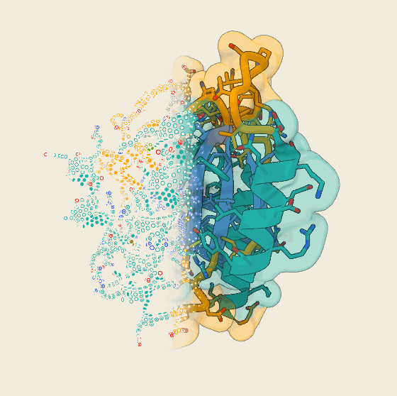

# ASCII Fold

Based on [ascii-fold](https://github.com/mitsenkov/ascii-fold) by Maxim Tsenkov, extended here with ChimeraX-style rendering, side chains, ligands, several chains, labels and more.

Spinning protein structures drawn as ASCII text that dissolves into a cartoon ribbon or a molecular surface. Open a `.pdb` / `.cif` file (from [AlphaFold DB](https://alphafold.ebi.ac.uk), the PDB or your own) and it's drawn in your browser. There's no server and no build step to run it.

<p align="center"></p>

- **Text in 3D.** Glyphs are printed on the surface of the chain: they shrink and fade with distance, hide behind nearer parts, darken on the side away from the light and foreshorten as the surface turns away. The text takes the cartoon's shape: helices are twisting ribbons, strands are flat arrows and loops are thin tubes, so text and ribbon line up exactly where one turns into the other. Side chains and ligands are printed too, as strings of glyphs along their sticks and a ball of glyphs for each ion, in their element colours (on paper, the palest, such as sulfur's yellow, are darkened so thin glyphs stay readable). A Perspective slider sets how strongly near parts loom.
- **Text → ribbon blend.** One projection drives the text and a canvas cartoon, so they always line up. The handover is a fixed dither, like a halftone.
- **Your structures.** Open or drop a `.pdb` / `.cif` file (gzipped is fine) on the page; the embeddable element can also fetch AlphaFold DB models by accession. Colour by secondary structure, by pLDDT (the B-factor column of any file whose B-factors vary, so any predictor's model works; 0–1 values are rescaled to 0–100), by chain, or in one colour: a row of favourites plus ChimeraX's basic colours.
- **Several chains.** Every protein chain in the file is drawn (for a complex over 6000 residues, the first chain to start with), with a chip per chain to show or hide it. The sequence panel lays the chains side by side, each under its name, and colours and labels stay with their residues when chains come and go.
- **Surface.** Show the molecular surface instead of the cartoon, built from every heavy atom at its van der Waals radius, as in ChimeraX. It's drawn as a smooth triangle mesh with WebGL and lit like ChimeraX's gentle lighting, with depth cueing only in the back half. The text is printed on the same surface. Files with only Cα atoms get a smoother residue-level surface. **Both** puts a see-through surface over the cartoon: only its front layer, a little more opaque where it turns away, with a light outline (Opacity sets how much). Ligands that come out of the protein stay clear of it.
- **Sequence panel.** The chain's sequence runs along the bottom with its helices and strands. Drag across residues or click a helix or strand to select it, or select every helix, strand or loop at once from the Colour panel (Shift adds), then pick a colour to recolour just those residues.
- **Side chains.** Show side chains as sticks with the cartoon, for all residues or just those selected in the sequence, as in ChimeraX: 0.2 Å sticks and balls, carbons in the residue's colour, N, O and S by element, each side chain growing out of the cartoon.
- **Ligands and ions.** Bound ligands are drawn as sticks and ions as balls, with the cartoon or in their pocket on the surface. Carbons are gray, other atoms take ChimeraX's element colours (P orange, Mg green …), and each ligand gets a chip under the sequence: click it (Shift adds) and pick a colour to recolour its carbons, or an ion. Water and common crystallisation additives (glycerol, PEG, buffers) are left out. Ligands that sit on a chain of their own, as AlphaFold 3 and Boltz write them, are picked up too. The Ligands switch hides them.
- **Shading.** The cartoon keeps every helix and strand one even colour that darkens with distance from the camera along the line of sight, so the back of the model sinks into deeper shades while the front stays full colour (the Depth slider sets how dark the back-most parts get); loops keep a touch of roundness. Turn on Helix faces to lighten the outside of each helix turn (its side-chain side) and darken the inside seen through the gaps, so turns facing you stand out from the far side. The surface is lit after ChimeraX's `lighting gentle`: soft ambient light with ambient occlusion, so grooves and buried faces darken. Both are real 3D meshes rendered with WebGL, with ChimeraX-style silhouette outlines.
- **Labels.** Click a residue or ligand in the view to pin a label to it ("D12", "GCP"); click it again to take it off, or label a whole selection from the sequence panel. Labels sit on short leader lines pointing out from the model and go into every export.
- **Shape controls** (in the settings panel, under Glyphs and shape). Flatten strands and size their arrowheads. Helices are flat ribbons on a fitted ideal helix (2.2 Å wide and paper-thin by default). Set thickness and width for helices, strands and loops.
- **Zoom and detail.** Zoom adds characters instead of enlarging them (the 3D text re-samples in half-octave steps). The Detail setting picks the number of text rows, which also sets the 3D glyph size.
- **Motion.** Spin turns the model all the way round, or rocks it ±30° (Rock).
- **Export.** Images as PNG at 1×, 2× or 4× (rendered afresh, with the text drawn as real glyphs so it stays sharp), on paper or a transparent background. Animations as a GIF or a video (WebM, or MP4 where that's what the browser records): one seamless loop, a full turn or one rock, up to 1080 px wide.
- **Saved views.** Save view writes everything about the picture (settings, shape, angle, zoom, chains, colours, side chains and labels) to a small `.json` file; open it, or drop it on the page, to get the same picture back on the same structure.
- **Embeddable.** `<ascii-fold accession="P01116">` works on any page.

## Run it

```bash
git clone https://github.com/samuel-novak-dev/ascii-fold.git
cd ascii-fold
npx serve .            # or: python3 -m http.server
```

Then open the printed URL. ES modules need a web server, so double-clicking `index.html` won't work. For a single file you can open from disk, use `dist/ascii-fold-standalone.html`.

## Deploy your own

If you deploy somewhere other than `https://samuel-novak-dev.github.io/ascii-fold/`, update the `og:url` and `og:image` tags in `index.html`. Social sites need absolute URLs for the preview image (`docs/og.png`).


The site is static, so any static host works.

**GitHub Pages:** fork the repo, then go to **Settings → Pages → Source → GitHub Actions**. The workflow in `.github/workflows/pages.yml` builds and publishes on every push to `main`. Your copy appears at `https://<you>.github.io/ascii-fold/`.

**Netlify / Vercel / Cloudflare Pages:** connect the repo, set the build command to `npm run build` and the output directory to `.` (repo root).

**Anywhere else:** upload `dist/ascii-fold-standalone.html` and rename it `index.html` if you like.

AlphaFold DB sends CORS headers, so visitors' browsers fetch models directly and you don't need a proxy.

## Embed it

```html
<script type="module" src="https://cdn.jsdelivr.net/gh/samuel-novak-dev/ascii-fold@main/dist/ascii-fold.js"></script>

<ascii-fold accession="P04637" theme="night" colour="plddt" style="height: 420px"></ascii-fold>
```

| Attribute | Values | Default |
|---|---|---|
| `accession` | UniProt accession, fetched from AlphaFold DB | bundled KRAS (PDB 6GJ8) |
| `src` | URL of a `.pdb` / `.cif` file (must be CORS-readable) | |
| `theme` | `paper` · `night` | `paper` |
| `colour` | `ss` · `plddt` · `chain`, or one colour: a ChimeraX basic colour name (`red`, `orange red`, `cornflower blue`, `light sea green`, `dim gray` …) or a hex value | `ss` |
| `layout` | `lr` (text→ribbon) · `rl` · `ascii` · `ribbon` | `lr` |
| `perspective` | 0–1; 0 is orthographic | `1` |
| `depth` | 0–1: how dark the back-most parts get (the front always stays full colour) | `0.6` |
| `helix-faces` | present: lighten helix outsides, darken their insides | |
| `sidechains` | `all` · `none`: side chains as sticks with the cartoon | `none` |
| `ligands` | `off` hides ligands and ions | shown |
| `chains` | which protein chains to draw, e.g. `A,B` | all |
| `surface` | present: show the molecular surface instead of the cartoon; `both`: a see-through surface over the cartoon | |
| `glass-opacity` | 0–1: how opaque the surface is with `surface="both"` | `0.3` |
| `glyphs` | `classic` · `blocks` · `geo`, or your own light→dark ramp | `classic` |
| `detail` | `xcoarse` · `coarse` · `medium`, or a row count | `medium` |
| `spin` | rotation speed, 0–1 | `0` (still) |
| `motion` | `turn` · `rock` (±30°) | `turn` |
| `view` | URL of a saved view (`.json` from the app's Save view), applied once the structure loads | |
| `blend-from`, `blend-to` | where the blend starts and ends, 0–1 (not in the app's panel) | `0.4`, `0.6` |
| `interactive` | `false` disables drag and zoom | |
| `transparent` | no background fill | |
| `no-credit` | hides the AlphaFold DB credit line (credit it elsewhere) | |

Size the element with CSS; it defaults to 360 px tall. It fires `fold-load` and `fold-error` events and exposes the engine as `element.view`. `examples/embed.html` shows a few variants.

For a bigger view on your homepage, embed the full app in an `<iframe>`, or use the element above.

## Use the engine directly

```js
import { createAsciiFold } from "./src/index.js";   // or the dist bundle

const view = createAsciiFold(document.querySelector("#box"), { theme: "night", colour: "plddt" });
await view.loadAccession("P42212");
view.setShape({ hW: 1.4, flat: 1 });
view.set({ spin: 0.35, perspective: 0 });   // turning, no perspective
view.set({ surface: true, colour: "cornflower blue" });
view.setRotation(1.2, -0.3);
const png = view.snapshot({ scale: 4, transparent: true });   // data URL: the current frame, re-rendered at 4×
const gif = await view.recordGif({ frames: 60, width: 720 });   // Blob: one seamless loop (a turn, or a rock)
const vid = await view.recordVideo({ fps: 30, width: 1080 });   // Blob: the same loop as WebM (or MP4)
view.showChains(["A", "B"]); view.set({ colour: "chain", glass: true, motion: "rock" });
view.label("residue", 11);         // pin "D12" (residue index 11)
const saved = view.getView();      // plain data; view.setView(saved) brings it back
const txt = view.text();           // the protein as plain ASCII text
```

Other methods: `rotation` (the orientation as a 3×3 matrix), `showSideChains("all" | indices | null)`, `ligands()`, `ligandColours()`, `colourLigands(indices, colour)`, `chains()`, `labels()`, `clearLabels()`, `pick(x, y)`, `loopSeconds()`, `set(options)`, `loadFile(file)`, `loadText(text)`, `loadDefault()`, `zoomBy(f)`, `resetView()`, `palette()`, `residues()`, `residueColours()`, `colourResidues(indices, colour)`, `clearResidueColours()` (ligand colours too), `on("load" | "zoom" | "colour" | "chains" | "labels" | "pick", fn)` and `destroy()`. A click on the model (not a drag) fires `pick` with what's under it. In the app, the view is available as `window.asciiFold`.

## How it works

1. **Parse.** Read every heavy atom of every protein chain in the first model from PDB or mmCIF, with no dependencies (`src/parse.js`). A HETATM residue with a backbone (selenomethionine, phosphothreonine …) stays part of its chain. Every other HETATM group counts as a ligand if any of its atoms is within 5 Å of a protein chain, whichever chain it's on itself; water and a short list of crystallisation additives are skipped. The pLDDT colour reads the B-factor column whenever its values vary (0–1 scales are rescaled to 0–100). Whether to call them pLDDT in the subtitle is a guess: yes when the file says so (ModelCIF's `_ma_qa_metric`, or "pLDDT"), when they were on a 0–1 scale, or, unless the file declares an experimental method, when a predictor is named or every residue carries one value on all its atoms; otherwise it shows the mean B-factor.
2. **Secondary structure.** Use HELIX/SHEET records when present. Otherwise assign it from Cα distances alone (`src/ss.js`, P-SEA-like). This agreed with deposited assignments on about 80–86% of residues in our checks, which is fine for drawing but not for analysis.
3. **Geometry.** Draw a Catmull-Rom spline through Cα, chain after chain, with a break between chains that no helix, strand or spline crosses. Orient the ribbon using the backbone C=O directions. Smooth the strand pleats on request, and fit helix axes for the ideal helices (`src/geometry.js`).
4. **Text.** Glyphs sit on the cartoon's own surfaces: rows across both faces and the edges of helix and strand bands, and rings around loop tubes, using the same widths as the ribbon. Side-chain and ligand sticks get rings of glyphs along each half-bond and ions a Fibonacci sphere of them, sampled by the same code that builds their meshes (`src/sticks.js`). Each frame they are rotated with the model and dropped when they face away. The rest are splatted into a depth buffer, and any glyph with a nearer surface in front is dropped too. The survivors are sized by perspective, fogged by depth, laid into the surface's tangent plane and drawn back to front from a pre-rendered glyph atlas. A small paper disc under each glyph hides ink further back. Large snapshots skip the atlas and draw every glyph as real text, so it stays sharp at any size. Copy text is separate: it splats spheres along the chain into a z-buffered cell grid and maps each cell's light and depth to a glyph ramp.
5. **Cartoon.** Build the cartoon as a triangle mesh (`src/cartoon.js`): round tubes for loops, flat bands for helices and strands (a thin box, or a two-sided sheet when they have no thickness), and arrowheads, all from the same spline points, frames and widths as the 3D text. `src/glview.js` draws it with WebGL in the same (perspective) projection as the text. Without WebGL, a 2D painter's-algorithm ribbon stands in. Each helix of 4+ residues is drawn along an ideal helix: constant radius and twist around the fitted axis, with its phase and twist least-squares fitted to the real Cα (0.3–0.8 Å RMSD on KRAS). It eases back onto the path through the real Cα over the last residue and a half, so loops join smoothly. The picture is smoother than the data, on purpose.
   **Surface.** A blobby isosurface (`src/surface.js`): each heavy atom adds exp(−B·(d²/r² − 1)) to a field, with r its Bondi van der Waals radius, and the surface is where the field is 1. A lone atom is a sphere of its radius, and neighbours merge smoothly, filling crevices much as a solvent probe does. The field is sampled on a grid (0.55 Å, coarser for big proteins) and triangulated with surface nets, with normals and residues taken from the atoms. `src/glview.js` draws it the same way as the cartoon. With Both, it's drawn after the cartoon and its outlines, into the same depth buffer: a depth-only pass first, then colour only where the surface's front layer won, blended over the picture with a light outline of its own. The 3D text sits on evenly spaced mesh vertices. Without side chains, the same method runs on one soft 3.4 Å ball per residue.
   **Shading.** The cartoon's colour is scaled by its distance to the camera (with perspective, the true distance along the line of sight), stretched over the model's own front and back in the current view: the front-most structure is always full colour and the back-most falls to 1 − 0.9 × Depth (46% by default, 10% at the top of the slider); band vertices get no other shading, so each element stays one even colour, and loop tubes add a faint key light for roundness. Helix ribbon normals point away from the fitted helix axis, toward the side chains; with Helix faces on, the outside of a turn is mixed 16% toward white and the inside is darkened to 58%. The surface uses ambient occlusion per vertex: the share of 40 directions over its hemisphere that escape the protein within about 11 Å (like ChimeraX's multishadow), plus a little key light and depth cueing in the back half. The 3D text uses the Cα density just outside each glyph.
   **Side chains.** `src/sticks.js` bonds each residue's side-chain atoms (plus Cα, and N for proline) by distance (covalent radii + 0.45 Å) and builds 0.2 Å sticks, split at the middle so each half takes its atom's colour, with a ball at every atom. The Cα is drawn at the residue's point on the cartoon, so the side chain grows out of the ribbon even where the helix is idealised. Ligands are built the same way, bonded within each ligand (metal coordination is not drawn as a bond); an ion is one ball of 0.45 × its van der Waals radius (0.6–1.3 Å).
   **Silhouettes.** With WebGL2 the model is rendered into a multisampled buffer, and a second pass draws a thin dark outline wherever depth jumps by more than ~1.6 Å, like ChimeraX's silhouettes.
   **Rotation.** The orientation is a rotation matrix turned like a trackball: drags and the spin rotate about the screen's own axes, with no gimbal limits.
   **Depth cue.** As in ChimeraX, the front half of the model is untouched and the back half fades toward the background.
6. **Blend.** A fixed random mask hands each glyph to either the text or the model according to its horizontal position, and the model fades in under the text.

`scripts/bundle_pdb.py` packs one chain of a PDB file (all heavy atoms, ligands and ions included, plus HELIX/SHEET) into the compact module used for the bundled structure.

## Develop

```bash
npm install
npm run dev        # static server on :5173
npm run build      # dist/ascii-fold.js (ESM), dist/ascii-fold.iife.js (global AsciiFold), dist/ascii-fold-standalone.html
```

```
src/
  engine.js               createAsciiFold(): rendering, interaction, public API
  geometry.js             spline, ribbon frames, shape parameters
  cartoon.js              cartoon triangle mesh (tubes, bands, arrows)
  sticks.js               side chains and ligands as sticks, ions as balls (bonds by distance, element colours)
  surface.js              molecular surface mesh (van der Waals atoms or Cα), ambient occlusion, text points
  glview.js               WebGL renderer: depth-shaded cartoon, lit surface, see-through surface, silhouettes
  parse.js · ss.js        PDB/mmCIF reader, Cα-only secondary structure
  afdb.js                 AlphaFold DB fetch + accession handling
  ascii-fold-element.js   <ascii-fold> web component
  app.js                  the full-page app (index.html)
```

## Data and credits

- Models come from the **AlphaFold Protein Structure Database** (EMBL-EBI and Google DeepMind). AlphaFold data is © 2021 DeepMind Technologies Limited, licensed [CC BY 4.0](https://creativecommons.org/licenses/by/4.0/), and use of AlphaFold DB is subject to the [EMBL-EBI Terms of Use](https://www.ebi.ac.uk/about/terms-of-use/). The app and the component show a credit line; please keep it, or credit AlphaFold DB elsewhere on your page. If you use the predictions in your work, cite Jumper et al., *Nature* (2021) and the current database paper listed on the [AlphaFold DB homepage](https://alphafold.ebi.ac.uk).
- The bundled default structure is **PDB 6GJ8** (KRAS G12D) chain A with all heavy atoms and its ligands (GMPPCP, Mg²⁺ and the inhibitor BI-2852), from the [Protein Data Bank](https://www.rcsb.org/structure/6GJ8) (CC0).
- The font is **JetBrains Mono**, loaded from Google Fonts under the SIL Open Font License.
- GIF encoding uses [gifenc](https://github.com/mattdesl/gifenc) by Matt DesLauriers (MIT), vendored in `src/vendor/`.

## Citation

This project builds on **ascii-fold** by Maxim Tsenkov: <https://github.com/mitsenkov/ascii-fold> (MIT). If you use it, please cite or link the original repository as well as this one:

> Tsenkov, M. *ascii-fold: spinning protein structures drawn as ASCII text.* https://github.com/mitsenkov/ascii-fold

## License

The code is [MIT](LICENSE), as in the original project; its copyright notice is kept in `LICENSE`. Structure data keeps its own licence (see above).
